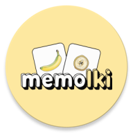
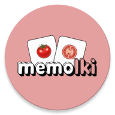
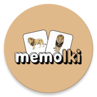
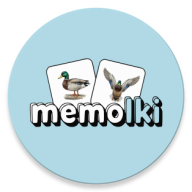

# 🃏 memolki

> A production memory card game built with Kotlin Multiplatform + Compose Multiplatform, published on Google Play in multiple themed flavors with multi-language support. iOS support is in active development.


<br>


## 📲 Google Play

<table>
  <tr>
    <td valign="middle"><a href="https://play.google.com/store/apps/details?id=com.wojdor.memolki.fruithalf"></a></td>
    <td valign="middle"><b>memolki • fruits</b></td>
    <td valign="middle"><a href="https://play.google.com/store/apps/details?id=com.wojdor.memolki.fruithalf"></a></td>
  </tr>
  <tr>
    <td valign="middle"><a href="https://play.google.com/store/apps/details?id=com.wojdor.memolki.vegetablehalf"></a></td>
    <td valign="middle"><b>memolki • vegetables</b></td>
    <td valign="middle"><a href="https://play.google.com/store/apps/details?id=com.wojdor.memolki.vegetablehalf"></a></td>
  </tr>
  <tr>
    <td valign="middle"><a href="https://play.google.com/store/apps/details?id=com.wojdor.memolki.mammalside"></a></td>
    <td valign="middle"><b>memolki • mammals</b></td>
    <td valign="middle"><a href="https://play.google.com/store/apps/details?id=com.wojdor.memolki.mammalside"></a></td>
  </tr>
  <tr>
    <td valign="middle"><a href="https://play.google.com/store/apps/details?id=com.wojdor.memolki.birdside"></a></td>
    <td valign="middle"><b>memolki • birds</b></td>
    <td valign="middle"><a href="https://play.google.com/store/apps/details?id=com.wojdor.memolki.birdside"></a></td>
  </tr>
</table>

## 🎯 Overview

Memolki is a card-matching memory game where players flip cards to find matching pairs. The app ships as **multiple themed flavors** — each with unique branding, card artwork, and Play Store listing — all powered by a shared Kotlin Multiplatform game engine and Compose Multiplatform UI.

## ✨ Features

**Core Gameplay**
- Multiple board sizes with casual and daily challenge modes
- Progressive level system — unlock boards by matching pairs
- Coins economy — earn from gameplay, spend to unlock card sets
- Deterministic seeding for daily challenges (same puzzle for all players)

**Engagement & Social**
- Google Play Games integration — leaderboards and achievements (Game Center on iOS, in progress)
- Share results with friends (earns bonus coins)
- Daily login streaks with reminder notifications
- App shortcuts for quick access to daily challenge and shop (Android)

**Monetization**
- AdMob rewarded ads (Android live, iOS in progress)
- In-app review prompts via Google Play In-App Review API / `SKStoreReviewController`
- Google Play Billing on Android, StoreKit 2 on iOS (in progress)

**Localization**
- Multi-language support including RTL (Arabic, Hebrew)
- In-app language switching without restart
- Per-flavor card name translations via Compose Resources

**Notifications**
- Firebase Cloud Messaging with topic-based subscriptions (per-flavor + per-language)
- Deep link routing to specific screens (shop, daily challenge, collection)
- Local notification reminders (daily challenge, streak)

## 🧩 Module Structure

```
memolki/
├── shared/        Kotlin Multiplatform library
│   ├── commonMain/   UI (Compose Multiplatform), ViewModels, use cases, repositories, models
│   ├── androidMain/  Android `actual` impls (Encryptor, providers, media players, etc.)
│   ├── iosMain/      iOS `actual` impls (Keychain, AVAudioPlayer, UNUserNotificationCenter, …)
│   └── {flavor}Main/ Per-flavor card catalog + card images via composeResources
├── androidApp/    Android app shell (AppActivity, manifest, receivers, flavor source sets)
└── iosApp/        iOS app shell (SwiftUI @main App, Compose host, 4 Xcode schemes)
```

The active iOS flavor is selected per-Xcode-scheme via a pre-action that writes `iosApp/.active-flavor` before `:shared:syncFramework` runs — this lets the framework bundle only one flavor's resources at a time, keeping `.app` size lean.

## 🏗️ Architecture

**MVI + Clean Architecture** with strict unidirectional data flow:

```
UI Layer (Compose Multiplatform — commonMain)
        ↓ Intent
Domain Layer (Use Cases → Flow<Result<T>>)
        ↓
Data Layer (Repositories → DataSources)
        ↓ State
UI Layer (Compose Multiplatform — commonMain)
```

### Screen Structure

Every feature screen follows a consistent **3-level composable hierarchy**:

1. **Entry point** — collects state from ViewModel, delegates to handlers
2. **Effect handler** — processes one-shot side effects (navigation, toasts)
3. **State handler** — wires callbacks to intents, renders stateless UI

This pattern enforces separation of concerns, enables previews for every screen, and keeps navigation logic isolated. All Screens, ViewModels, and MVI types live in `:shared/commonMain` — Android and iOS share the same composables.

### Key Design Decisions

- **Use Cases** — each encapsulates a single business operation, returns `Flow<Result<T>>`
- **Strict layer boundaries** — domain never imports data-layer internals
- **Injectable dispatchers** — coroutine dispatchers injected via Koin named qualifiers (`DefaultDispatcher`, `MainDispatcher`), never hardcoded
- **expect/actual** — platform APIs (Encryptor, audio, notifications, billing, ads, game services) declared as `commonMain` interfaces with `Android*` / `Ios*` implementations
- **Encrypted DataStore** — AES-GCM authenticated encryption for sensitive persistent data (coins, streaks)
- **Room Database** — KMP-compatible structured storage for daily challenge history with proper migrations

## 🛠️ Tech Stack

| Category | Technology |
|----------|-----------|
| **Language** | Kotlin (Multiplatform) |
| **UI** | Compose Multiplatform + Material 3 (commonMain — Android & iOS) |
| **Architecture** | MVI + Clean Architecture |
| **DI** | Koin (no annotations — constructor-based, wired in `sharedKoinModule` / `appKoinModule` / `iosKoinModule`) |
| **Navigation** | Navigation Compose (Multiplatform) |
| **Persistence** | DataStore Preferences (encrypted) + Room (KMP) |
| **Async** | Kotlin Coroutines + Flow |
| **Resources** | `compose-resources` (commonMain + per-flavor source sets) |
| **Analytics** | Firebase Analytics + Crashlytics (GitLive KMP wrapper + native iOS pods) |
| **Messaging** | Firebase Cloud Messaging (Android: native FirebaseMessaging, iOS: APNs + FCM via GitLive) |
| **Ads** | AdMob (Android live, iOS in progress) |
| **Play Services** | Games v2, Auth, Billing, In-App Review, In-App Updates |
| **iOS Native** | StoreKit 2, GameKit, CryptoKit + Keychain, AVFoundation (in progress) |
| **iOS Tooling** | xcodegen + CocoaPods (via Kotlin's `native.cocoapods` plugin) |
| **Build** | Gradle with version catalog, ProGuard/R8 |
| **CI/CD** | GitHub Actions + Gradle Play Publisher |
| **Testing** | JUnit 4, hand-written Fakes, Turbine, Paparazzi |
| **Coverage** | Kover with badge generation |

## 🧱 Build & Run

### Android

```bash
# Build a flavor (Debug)
./gradlew :androidApp:assembleFruitHalfDebug

# Install + launch on connected device/emulator
./gradlew :androidApp:installFruitHalfDebug && \
  adb shell am start -n com.wojdor.memolki.fruithalf/com.wojdor.memolki.ui.app.AppActivity
```

### iOS

```bash
# 1. Generate the Xcode project from project.yml
cd iosApp && xcodegen generate

# 2. Install pods (also runs :shared:syncFramework via the Kotlin cocoapods plugin)
pod install

# 3. Open the workspace and run any of the 4 schemes:
#    iosApp-FruitHalf, iosApp-VegetableHalf, iosApp-MammalSide, iosApp-BirdSide
open iosApp.xcworkspace

# Or build from CLI:
xcodebuild -workspace iosApp.xcworkspace \
  -scheme iosApp-FruitHalf \
  -sdk iphonesimulator \
  -destination "platform=iOS Simulator,name=iPhone 17 Pro" \
  CODE_SIGNING_ALLOWED=NO build
```

Each Xcode scheme has a pre-action that writes its flavor name to `iosApp/.active-flavor`, which `shared/build.gradle.kts` reads to wire the per-flavor source set into `iosMain` for that build.

## 🧪 Testing

Covers the full business logic layer:

- **Unit tests** for all ViewModels, Use Cases, Repositories, and DataSources (in `:shared/commonTest` where possible, `:androidApp`/`:shared/androidUnitTest` for Android-specific glue)
- **Screenshot tests** via Paparazzi — snapshot verification for all `@Preview` composables (Android-only, recorded against the `fruitHalf` flavor)
- **Fakes-first** — platform calls (`Context`, `LocaleManager`, `PackageManager`, etc.) abstracted via commonMain interfaces / `expect`-`actual` providers, each with a hand-written `FakeFoo` for tests
- **Flow testing** with Turbine for async assertions
- **Parameterized tests** via Test Parameter Injector

```bash
# Run all unit tests for a flavor
./gradlew :androidApp:testFruitHalfDebugUnitTest

# Verify screenshot tests
./gradlew :androidApp:verifyPaparazziFruitHalfDebug

# Generate coverage report
./gradlew :androidApp:koverXmlReportFruitHalfDebug
```

## 🔄 CI/CD

| Workflow | Trigger | Actions |
|----------|---------|---------|
| **Pull Request** | Every PR | Unit tests, screenshot verification, coverage report on PR summary |
| **Coverage** | Merge to main | Generate unit test coverage badge, update via GitHub Gist |
| **Merge** | Merge to main | Build release bundles for all flavors, publish to Google Play |

## 🛡️ Anti-Cheat & Security

- **Encrypted game state** — all critical values (coins, levels, streaks, matched pairs) stored with AES-256-GCM authenticated encryption via a custom `Encryptor` layer on top of DataStore. Android uses Tink-backed `AndroidKeyStore`; iOS uses CryptoKit + Keychain (in progress)
- **IAP signature verification** — Android purchase validation using RSA + SHA1 against the Google Play billing public key, with proactive hacked-signature detection that rejects tampered billing systems. iOS will use StoreKit 2's `Transaction.verificationResult` (in progress)
- **R8 obfuscation** — Android release builds use ProGuard/R8 with resource shrinking enabled to hinder reverse engineering

## 🎨 Custom Compose Components

Reusable composable library (all in `:shared/commonMain`):

- **Animations** — `PulseEffect`, `ShakeEffect`, `ShimmerEffect`, `SparklesOverlay`, `EdgeSparklesEffect`
- **Card flip** — `Flippable` with 3D rotation animation
- **Auto-sizing text** — `AutoSizeText` that scales to fit container
- **Click effects** — `bounceClickEffect()` with throttle protection
- **Recording overlay** — `ClickIndicatorOverlay` showing tap points during video capture

## 🎬 Automation & Tooling

| Script | Purpose |
|--------|---------|
| `scripts/screenshot/` | Automated Play Store screenshot capture and composition with device frames |
| `scripts/recording/` | Video recording with deterministic gameplay, ffmpeg post-processing (music, fades, logos) |
| `scripts/listing/` | Play Store listing fetch/update across all flavors and languages |
| `scripts/notifications/` | FCM push notification sender |
| `scripts/image_generation/` | Card image resizing across density buckets |
| `scripts/youtube/` | YouTube thumbnail generation and upload |

## 📚 Documentation

Detailed docs live in [`docs/`](./docs/docs.md) covering setup, logo generation, card image preparation, app icon setup, flavor onboarding, Play Store listing management, screenshot & video automation, and more.

## 📄 License

```
Copyright 2026 Wojciech Kryg. All Rights Reserved.

This source code is made available for viewing purposes only.
No permission is granted to use, copy, modify, merge, publish,
distribute, sublicense, or sell copies of this software without
prior written approval from the copyright holder.

For licensing inquiries, contact the author.
```
